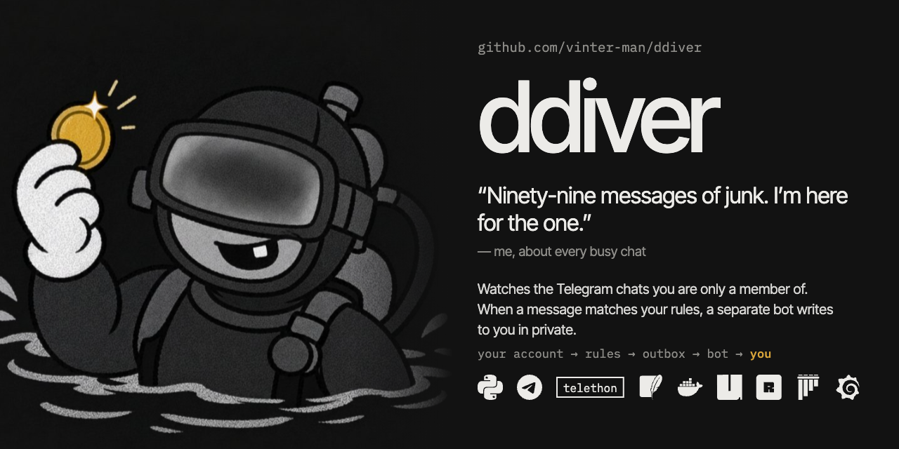
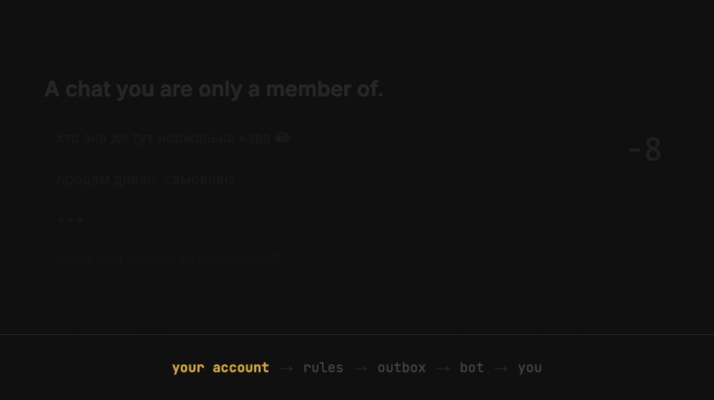
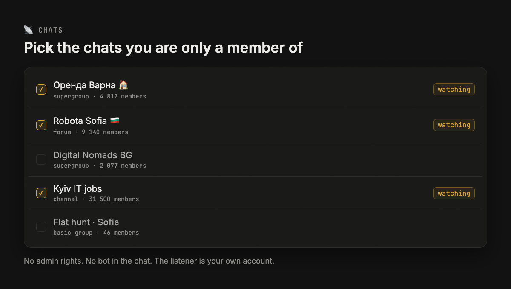
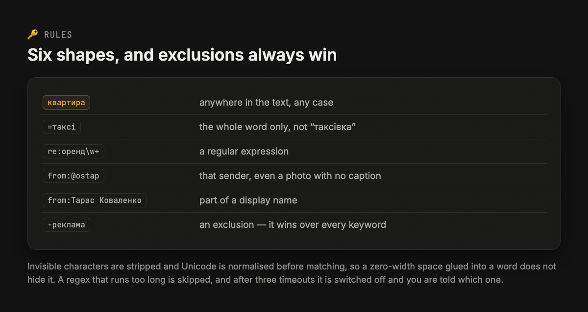
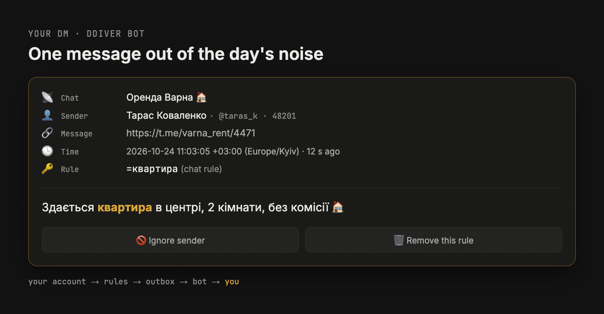
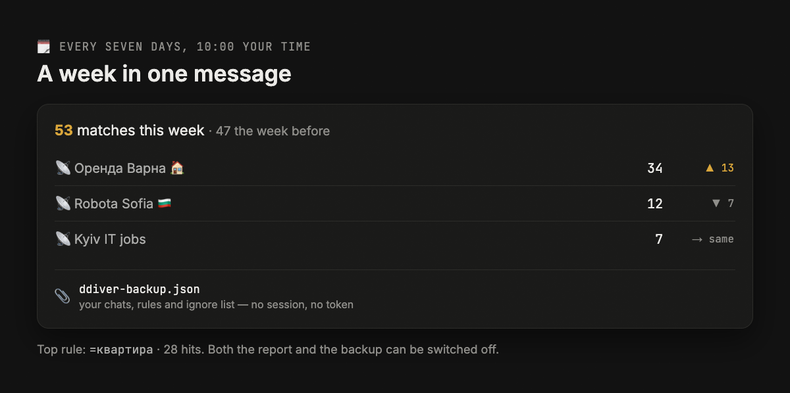
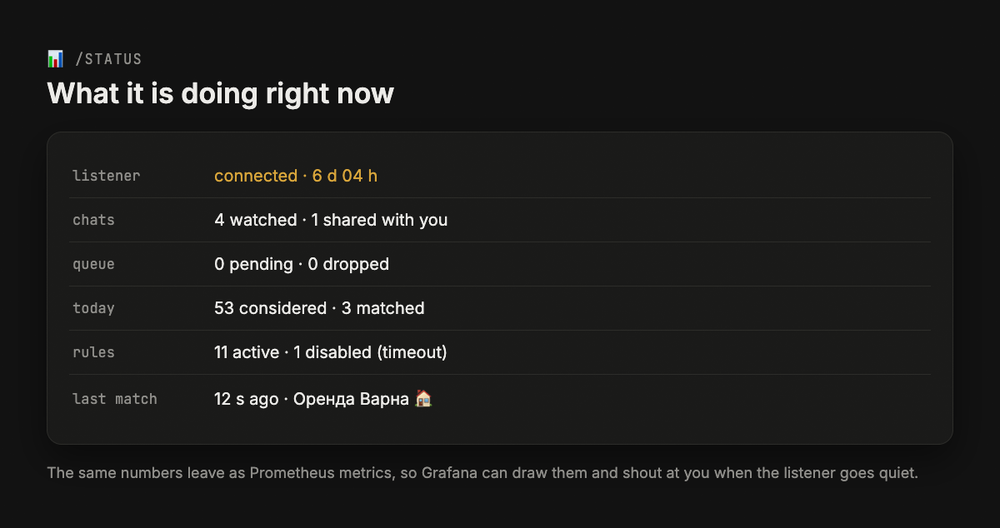

[](https://github.com/vinter-man/ddiver/actions/workflows/ci.yml)


[](LICENSE)



## Коротко

Я модерирую чаты, которые мне не принадлежат. Прав администратора нет, бота туда не посадить,
а в день там тысяча сообщений — и среди них одно, ради которого всё и затевалось.

Листает их ddiver. Ваш собственный аккаунт Telegram сидит в этих чатах и читает всё подряд;
когда сообщение попадает под ваше правило, **отдельный бот** пишет вам в личку: чат,
отправитель, кликабельная ссылка и сам текст. В чат при этом ничего не отправляется — аккаунт
только читает, а бот туда даже не вступает.

Интерфейс на uk, ru и en, язык спрашивается при первом `/start`.
English version — [README.md](README.md).



---

## Содержание

* [Как это выглядит](#guide)
  * [Выбрать чаты](#chats)
  * [Написать правила](#rules)
  * [Получить то самое сообщение](#notification)
  * [Неделя одним сообщением](#weekly)
* [Установка](#install)
  * [Docker](#docker)
  * [На VPS](#vps)
* [Команды](#commands)
* [Наблюдение](#watching)
* [Приватность](#privacy)
* [Как устроено](#hood)
* [Контакты](#contact)

---
---

## <a name="guide"></a> Как это выглядит

### <a name="chats"></a> Выбрать чаты

`/start`, язык и часовой пояс, затем **📡 Чаты**. В списке все диалоги, где есть ваш аккаунт —
группы, супергруппы, форумы, каналы. Отмечаете те, за которыми стоит следить.



Админом быть не нужно ни в одном из них. И в списке участников никто не найдёт постороннего
бота, потому что его там нет.

> :suspect: Под капотом слушатель подписан на *все* апдейты, а не на фильтр по чатам, и фильтрует
> уже ddiver. Звучит расточительно, но это не так: Telegram всё равно присылает эти апдейты
> вашему клиенту, а фильтр на уровне Telethon пришлось бы пересобирать на каждую галочку.
> `listener.py` отсеивает сообщение в памяти — чат подписан, отправитель не в игноре, сообщение
> новее момента подписки — и только потом что-то записывается.
>
> Один слушатель обслуживает нескольких модераторов. Владелец расшаривает конкретные чаты, а
> дальше у каждого свои правила, свой игнор-лист, свой язык и часовой пояс, и видно только то,
> чем с ним поделились.

### <a name="rules"></a> Написать правила

**🔑 Правила** → *Добавить*. Правило живёт либо в одном чате, либо во всех ваших сразу.



Исключения — тот же синтаксис с минусом, и они сильнее любого ключевого слова: `квартира`
плюс `-реклама` читается как «квартиры, но не объявления».

> :godmode: Перед сравнением из текста вычищаются невидимые символы и нормализуется Unicode,
> поэтому `кварти<zero-width space>ра` всё равно находится по `квартира`. А вот латиница,
> похожая на кириллицу, намеренно **не** схлопывается: `тaкси` с латинской «a» — другое слово,
> и тихо считать его тем же самым удивило бы сильнее, чем помогло. Нужно — пишите регулярку.
>
> Регулярки компилируются один раз, с таймаутом и измеренным лимитом размера, и гоняются через
> модуль `regex`, а не `re`: шаблон, способный повесить процесс, отклоняется прямо при
> добавлении, а просто медленный — пропускается. После трёх таймаутов правило отключается, и вам
> говорят, какое именно. Это `rules.py` и `matcher.py`, а `/test <текст>` прогоняет настоящий
> конвейер, чтобы проверить правило до того, как на него полагаться.

### <a name="notification"></a> Получить то самое сообщение



Ссылка открывает именно это сообщение — в публичном чате, в закрытом или в теме форума. Две
кнопки — это ровно то, что хочется в эту секунду: больше никогда не слышать этого человека или
удалить правило, которое только что сработало.

> :hurtrealbad: Совпадение записывается в outbox **до** отправки, поэтому его не теряет ни
> перезапуск, ни flood wait, ни оборванное соединение — и дважды оно не придёт. Если бот лежал,
> он дошлёт пропущенное с пометкой «пока вас не было»; если прилетел залп, он схлопнется в один
> дайджест вместо сорока уведомлений. `delivery.py` и `catchup.py`.
>
> Рассчитано на 50+ чатов и 100k+ сообщений в сутки: ограниченные очереди, один общий шлюз на
> flood wait и дочитывание пропущенного с лимитом на чат и на всё сразу — чтобы неделя простоя
> не превратилась в час проигрывания истории.

### <a name="weekly"></a> Неделя одним сообщением

Раз в семь дней, в десять утра по вашему времени: что поймали, где, какими правилами и как это
выглядит на фоне прошлой недели.



Вложением — ваша конфигурация в JSON: чаты, правила, игнор-лист. Ни сессии, ни токена там нет,
так что файл можно хранить там же, где вы держите бэкапы, а `/import` прочитает его обратно. И
отчёт, и вложение выключаются в **⚙️ Настройках**.

---
---

## <a name="install"></a> Установка

Нужны три вещи:

* `api_id` и `api_hash` с [my.telegram.org](https://my.telegram.org) → *API development tools*
* токен бота у [@BotFather](https://t.me/BotFather)
* свой Telegram id ([@userinfobot](https://t.me/userinfobot), либо его печатает `ddiver login`)

Один раз поставьте [uv](https://docs.astral.sh/uv/) — нужный Python он притащит сам.

```bash
git clone https://github.com/vinter-man/ddiver && cd ddiver
cp .env.example .env         # API_ID, API_HASH, BOT_TOKEN, OWNER_ID
uv sync
uv run ddiver login          # телефон, код, 2FA — сессия останется в ./data
uv run ddiver check-config   # токен, права и нажали ли вы уже Start
uv run ddiver run
```

Откройте бота и нажмите **Start**. В BotFather: `/setjoingroups` → **Disable** — этот бот пишет
только вам.

### <a name="docker"></a> Docker

```bash
cp .env.example .env
docker compose run --rm -it ddiver login   # пока сервис НЕ запущен
docker compose up -d
docker compose logs -f
```

В `./data` лежат сессия и база SQLite.

> :rage1: **Никогда не запускайте два процесса ddiver на одном каталоге данных.** Telegram
> отзывает сессию, которую используют из двух мест сразу, и вам придётся логиниться заново.
> ddiver берёт lock-файл и откажется стартовать, но *копия* каталога где-то ещё — это уже за
> пределами того, что видит блокировка.

### <a name="vps"></a> На VPS

[`deploy/README.md`](deploy/README.md) — всё целиком: скрипт, который приводит свежую машину в
порядок, пайплайн «пуш в `main` → сборка, деплой и проверка, что контейнер поднялся на новом
коммите», и как оставить сервер пригодным для ваших остальных пет-проектов.

---
---

## <a name="commands"></a> Команды

| Команда | Что делает |
|---|---|
| `/menu` | чаты, правила, игнор-лист, настройки, статус |
| `/test <текст>` | гоняет настоящий конвейер по этому тексту и говорит по каждому чату, пришло бы уведомление или нет |
| `/status` | состояние слушателя, аптайм, счётчики, очередь |
| `/export` / `/import` | конфигурация файлом и обратно; импорт добавляет, а не заменяет |
| `/help` | синтаксис правил на вашем языке |
| `/cancel` | выйти из любого диалога |

В меню владельца есть ещё **🗂 Общие чаты** и **👥 Пользователи**: какие чаты видны модераторам
и кого вообще пускать.

---
---

## <a name="watching"></a> Наблюдение



Ничего из этого не обязательно — ddiver работает и без всего перечисленного.

**Dead-man's switch.** Задайте `PING_URL`, и ddiver будет пинговать его раз в минуту. Направьте
на healthchecks.io, на push-URL Uptime Kuma, на что угодно, что поднимет крик, когда пинги
прекратятся. Это единственный алерт, который переживёт смерть машины — а именно так и выглядит
внезапно замолчавший чат.

```dotenv
PING_URL=https://hc-ping.com/your-uuid-here
```

**Метрики, логи, дашборды.** Один дополнительный compose-файл поднимает Prometheus, Loki, Alloy
и Grafana с уже готовым дашбордом.

```bash
docker compose -f docker-compose.yml -f deploy/docker-compose.observability.yml up -d
ssh -L 3000:127.0.0.1:3000 you@your-box    # Grafana слушает только localhost
```

> :godmode: Логи приезжают JSON-ом, с метками `level` и `logger`, поэтому их можно спрашивать, а
> не грепать: `{service="ddiver", level="ERROR"} | json | msg =~ ".*flood.*"`. Дайте агенту
> MCP-сервер Grafana — и *«сходи разберись, почему утром из того чата ничего не пришло»*
> становится вопросом, на который он отвечает сам.
>
> Замерено на свежем стеке: Prometheus 57 МБ, Loki 72 МБ, Grafana 99 МБ, Alloy 48 МБ — против
> 56 МБ самого ddiver. Закладывайте полгигабайта. Ровно потому, что это в пять раз больше
> самого бота, оно и живёт в отдельном файле.

Grafana умеет писать вам в Telegram, когда машина ещё жива, но что-то не так: сессия просит
релогин, слушатель десять минут не на связи, уведомления копятся. Две переменные — и следующий
деплой их подхватит. Отдельный токен для алертов лучше: тогда сообщение о том, что доставка
встала, не едет через бота, который как раз и встал.

```dotenv
ALERT_TELEGRAM_TOKEN=123456:AA...
ALERT_TELEGRAM_CHAT_ID=ваш-числовой-id
```

Без Docker: `METRICS_PORT=9109` отдаёт `/metrics`, `LOG_FORMAT=json` делает логи машиночитаемыми,
а `ddiver health` выходит с ненулевым кодом, когда heartbeat протух.

---
---

## <a name="privacy"></a> Приватность

ddiver читает чаты, где вы состоите, а люди в них ни на что не соглашались. Это стоит знать до
запуска — и до того, как отдать бота другому модератору.

| | |
|---|---|
| **Что хранится** | только совпавшие сообщения, не поток. Текст, название чата, id отправителя, имя и username, ссылка. Остальное оценивается в памяти и забывается |
| **Сколько** | семь дней, дальше ежедневная задача удаляет. Всё прочее в базе — ваша конфигурация |
| **Кто может прочитать** | тот, кто имеет доступ к диску машины, плюс каждый модератор, с которым вы поделились чатом |
| **Что уходит наружу** | уведомления в личку модераторам. Никакой телеметрии и никаких сторонних сервисов |
| **Как удалить** | удалите правило, чтобы не появлялись новые; удалите `data/ddiver.sqlite3`, чтобы убрать старые раньше срока |

Если вы в ЕС, это персональные данные по GDPR, и запуск делает вас контролёром. Для личного
инструмента модератора планка невысокая, но это не ноль.

> :rage1: `data/user.session` — это **и есть** ваш аккаунт Telegram: он может читать все ваши
> чаты и писать от вашего имени. ddiver держит `data/` в `0700`, не пишет текст сообщений в логи
> выше DEBUG и ничего не отправляет за вас — но если вы бэкапите этот каталог, бэкапьте его туда,
> куда не побоялись бы положить свой пароль.
>
> Пользовательский аккаунт через API-клиент — серая зона в правилах Telegram. ddiver только
> читает и никогда никуда не вступает и никому не рассылает, это самый безобидный край спектра.
> Риск всё равно не нулевой; отдельный аккаунт — разумная предосторожность.

---
---

## <a name="hood"></a> Как устроено

```
ваш аккаунт ─→ слушатель ─→ матчер ─→ outbox ─→ бот ─→ вы
   Telethon     в памяти     правила   SQLite   BotFather
```

Две телеграмные личности на одном event loop. Пользовательская сессия читает и никогда не пишет;
бот пишет и никогда не читает отслеживаемый чат. Между ними — таблица, поэтому падение не стоит
вам ничего, а залп стоит одного дайджеста вместо сорока сообщений.

uv-воркспейс из трёх пакетов:

| Пакет | Что внутри |
|---|---|
| `ddiver/` | всё, чему нужна пользовательская сессия: `listener.py`, `catchup.py`, `login.py`, `clients.py`, `runtime.py`, `config.py`, `__main__.py` |
| `packages/ddiver-core/` | всё, чему не нужна: `rules.py`, `matcher.py`, `storage.py`, `delivery.py`, `formatter.py`, `botclient.py`, `botruntime.py`, экраны бота, метрики, health, i18n. Что это за ядро и чем оно не является — в его [README](packages/ddiver-core/README.md) |
| `packages/ddiver-core-testing/` | фейки, общие для обоих наборов тестов; dev-зависимость, в образ не попадает |

Telegram доходит до ядра только внедрённым портом — `BotPort`, `History`, `EntityResolver`, —
поэтому сопоставление, хранение, доставка и форматирование проверяются офлайн на фейках и
виртуальных часах.

```bash
uv sync
uv run pytest -q          # 1019 тестов, подключение к Telegram не нужно
uv run ruff check . && uv run ruff format --check .
uv run mypy
```

> :shipit: [DESIGN.md](DESIGN.md) — архитектура, инварианты и обоснование каждого решения.
> [CLAUDE.md](CLAUDE.md) — короткая вводная для кодящего агента: в какой пакет вносить правку,
> как прогнать проверки так же, как их гоняет CI, и три случая, когда зелёные тесты и зелёный CI
> здесь всё равно врали.
>
> Шапка нарисована руками; гифка и все скриншоты выше — проект
> [Remotion](https://www.remotion.dev/) в [`docs/remotion`](docs/remotion), пересобирается через
> `npm run build`. Это макеты, и намеренно: настоящий скриншот настоящего чата в публичном README
> навсегда публикует чужое имя и чужое сообщение.

---
---

## <a name="contact"></a> Контакты

GitHub: [vinter-man](https://github.com/vinter-man)

Лицензия: [MIT](LICENSE) — берите и ныряйте
